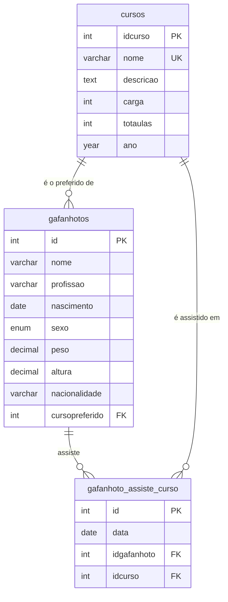

# Modelagem relacional em MySQL

Estudo prático de modelagem relacional: um cadastro de alunos e cursos, evoluído passo a passo até um relacionamento muitos-para-muitos, com consultas de junção e agrupamento.

Os dados de exemplo são fictícios e seguem o curso de MySQL do Curso em Vídeo; a organização dos scripts e a modelagem descrita abaixo são minhas.

## Modelo



- **1:N** — cada aluno (`gafanhotos`) pode ter um curso preferido; um curso pode ser o preferido de vários alunos. Chave estrangeira `cursopreferido → cursos.idcurso`.
- **N:N** — alunos assistem a vários cursos e cada curso tem vários alunos. A tabela associativa `gafanhoto_assiste_curso` guarda cada matrícula com sua data.
- **Integridade referencial** — as chaves estrangeiras impedem apagar um curso que ainda está ligado a alunos ou matrículas.

## Estrutura

| Arquivo | O que faz |
| --- | --- |
| [`modelo/00_criar_banco.sql`](modelo/00_criar_banco.sql) | Cria o banco `cadastro`. |
| [`modelo/01_gafanhotos.sql`](modelo/01_gafanhotos.sql) | Tabela de alunos e dados de exemplo. |
| [`modelo/02_cursos.sql`](modelo/02_cursos.sql) | Tabela de cursos, com nome único, e dados de exemplo. |
| [`modelo/03_curso_preferido_fk.sql`](modelo/03_curso_preferido_fk.sql) | Adiciona o curso preferido com chave estrangeira e testa a integridade referencial. |
| [`modelo/04_gafanhoto_assiste_curso.sql`](modelo/04_gafanhoto_assiste_curso.sql) | Cria a tabela associativa (N:N) e consulta alunos com seus cursos. |
| [`consultas/juncoes.sql`](consultas/juncoes.sql) | `RIGHT OUTER JOIN` e apelidos de tabela. |
| [`consultas/agrupamentos.sql`](consultas/agrupamentos.sql) | `GROUP BY`, `HAVING`, `COUNT` e `AVG`. |

## Como rodar

Com o MySQL 8 instalado, rode os scripts na ordem:

```bash
mysql -u root -p < modelo/00_criar_banco.sql
mysql -u root -p cadastro < modelo/01_gafanhotos.sql
mysql -u root -p cadastro < modelo/02_cursos.sql
mysql -u root -p cadastro < modelo/03_curso_preferido_fk.sql
mysql -u root -p cadastro < modelo/04_gafanhoto_assiste_curso.sql
```

Depois, rode os arquivos de `consultas/` no MySQL Workbench ou no terminal.

---

<details>
<summary><b>English</b></summary>

Hands-on relational modeling study in MySQL: a student/course registry evolved step by step into a many-to-many relationship, with join and aggregation queries. Sample data is fictional and follows the Curso em Vídeo MySQL course; the script organization and the model documented here are my own. See the diagram above and run the scripts in `modelo/` in numeric order.

</details>
